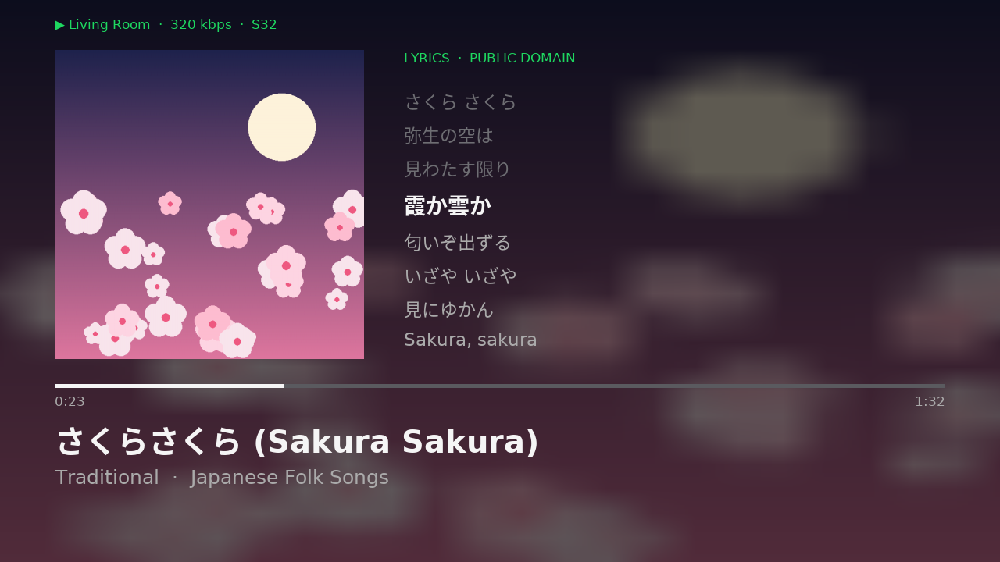
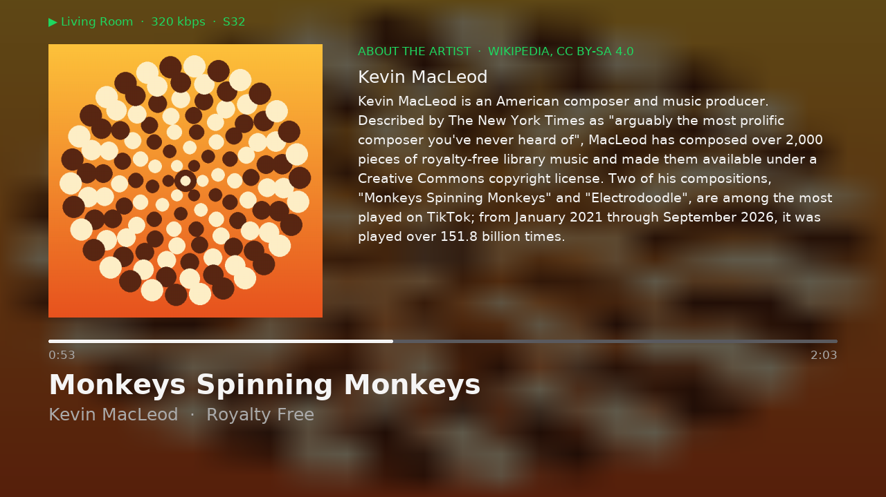
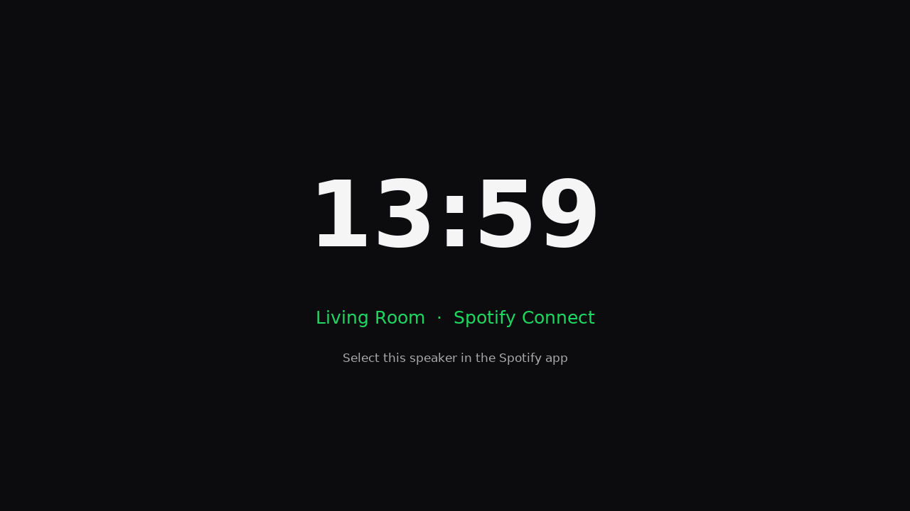

# pispot: Raspberry Pi Spotify Connect speaker

<p align="center">
  
</p>

<table>
  <tr>
    <td width="50%"></td>
    <td width="50%"></td>
  </tr>
  <tr>
    <td align="center"><sub>No lyrics? The artist's Wikipedia summary instead</sub></td>
    <td align="center"><sub>Idle: clock and speaker name</sub></td>
  </tr>
</table>

Unattended Raspberry Pi OS Lite (arm64) build that turns a Raspberry Pi into a
dedicated Spotify Connect speaker on your LAN. It plays over HDMI (or any ALSA
output) and shows a full-screen now-playing display on the same screen. Build
one image per room, each with its own speaker name and hostname.

Tested on a Raspberry Pi 3B v1.2. Other 64-bit Pis (3B+, 4, 5, Zero 2 W) should
work: the setup picks the first HDMI output it finds, and `pispot-config` can
switch to any other output.

- **Audio:** [raspotify](https://github.com/dtcooper/raspotify) (librespot)
  at 320 kbps Ogg Vorbis, the most Spotify serves to non-SDK Connect devices
  (no lossless, see below). Output is S32 to the vc4 HDMI sink (24-bit on the
  wire), with no normalisation and a float soft volume starting at 100 %.
- **Display:** cover art, synced lyrics ([LRCLIB](https://lrclib.net)) or the
  artist's Wikipedia summary when there are no lyrics, with the progress bar and
  title / artist · album underneath. Japanese, Chinese and Korean text renders
  through a Noto Sans CJK fallback.
- **Appliance:** Ethernet (plus optional Wi-Fi), SSH key login only, read-only
  root (overlayfs) so pulling the power is safe, and the services restart
  themselves if they crash.
- **`sudo pispot-config`:** SSH TUI to change the output device, bit depth,
  sample rate, bitrate, volume mode, speaker name, hostname and the display.
  Changes apply live and persist through the read-only root.

## Layout

| Path | What |
|---|---|
| `boot/user-data`, `meta-data` | cloud-init seed template (hostname, timezone, user `pi` + SSH key) |
| `boot/spotify-setup.sh` | first-boot script: apt (retries past captive portals), raspotify, HDMI format, display, pispot-config, lockdown, overlayfs |
| `system/pispot-config` | SSH TUI / CLI for audio and system settings |
| `display/nowplaying-event` | librespot `--onevent` hook → JSON in `/run/raspotify/np/` |
| `display/nowplaying.py` | pygame renderer → `/dev/fb0` (or `--render out.png`) |
| `display/*.service`, `*.conf` | systemd unit + raspotify drop-in setting `LIBRESPOT_ONEVENT` |
| `tools/build-image.sh` | wizard / CLI: build a `.img` (+ `.img.xz`), flash an SD card, or both |
| `tools/deploy.sh` | push `display/` and `pispot-config` to a running speaker (unlocks/relocks overlayfs) |
| `tools/preview.sh` | render a frame locally with real lyrics/bio lookups |
| `tools/screenshot.sh` | grab what the speaker's screen shows right now |
| `tools/make-screenshots.sh` | regenerate the README screenshots from free content |

## Usage

```bash
tools/build-image.sh                                  # wizard
tools/build-image.sh -n "Living Room" -z              # build/living-room.img + .img.xz
tools/build-image.sh -n Kitchen -w MyWiFi -p secret -c FR -f /dev/sdf   # build + flash
tools/build-image.sh -n "Room 12" -H room12 -t America/New_York       # one image per room
tools/build-image.sh -I build/pispot.img -f /dev/sdf   # flash an existing image
```

A Pi boots a raw disk image, not an ISO. The `.img.xz` works with Raspberry Pi
Imager ("Use custom") or balenaEtcher. In WSL, attach the card reader first with
`usbipd attach --wsl --busid <id>`. The flasher only accepts removable disks and
asks before erasing.

Boot the Pi with Ethernet (or the configured Wi-Fi) and HDMI plugged in. First boot takes about 10–15 min
and reboots once. Then pick your speaker (default **PiSpot**) in Spotify. Log: `/var/log/spotify-setup.log`.

```bash
tools/deploy.sh pi@pispot.local        # update the display on a running speaker
tools/preview.sh out.png "Cure For Me" AURORA "The Gods We Can Touch" 198853 61000
```

## Settings on the speaker

```bash
ssh pi@pispot.local
sudo pispot-config                     # menu
sudo pispot-config status
sudo pispot-config set format S32      # S16 S24 S24_3 S32 F32
sudo pispot-config set rate 96000      # 44100 = native/bit-perfect; others via speex resampler
sudo pispot-config set device hw:CARD=DAC,DEV=0
sudo pispot-config set volume fixed    # or soft
sudo pispot-config set hostname salon ; sudo pispot-config set name "Salon"
sudo pispot-config set display off
```

librespot always decodes at 44.1 kHz, so other rates go through an ALSA `plug`
(`/etc/asound.conf`, speexrate_best). That helps a DAC or amp that wants 48k, but
it can't add detail. With the read-only root active, each change is also written
to the real root through `overlayroot-chroot`. For anything else, unlock the root
from the menu or with `sudo raspi-config nonint disable_overlayfs && sudo reboot`.

## Display stack

```
Spotify app ─Connect─▶ librespot ─onevent─▶ nowplaying-event ─▶ /run/raspotify/np/*.json
                          │                                               │ polled
                          ▼                                               ▼
                    ALSA → HDMI audio          TV ◀─ HDMI ◀─ /dev/fb0 ◀─ nowplaying.py
```

`nowplaying.py` draws off-screen with SDL's dummy driver and copies each frame
to the fbdev framebuffer as RGB565. Going through KMS/EGL produced an ARGB
plane that the vc4 scanout showed as black.

## Limits

- **No lossless:** Spotify only serves FLAC to devices using its licensed SDK.
  librespot gets the 320 kbps Ogg stream
  ([librespot#1583](https://github.com/librespot-org/librespot/issues/1583)).
- **Lyrics:** coverage depends on LRCLIB. Unsynced lyrics scroll with the song,
  and when there are none the panel shows the artist bio instead.

## License and credits

pispot's own code is under the [MIT license](LICENSE). It is built on librespot,
raspotify, Raspberry Pi OS, pygame, Noto CJK and many other projects. Lyrics come
from LRCLIB and artist summaries from Wikipedia (CC BY-SA 4.0). See
[CREDITS.md](CREDITS.md) for every project, its license and what it is used for.
pispot is not affiliated with Spotify or Raspberry Pi Ltd.

The screenshots are rendered with `tools/make-screenshots.sh` and use only free
content: "Monkeys Spinning Monkeys" by Kevin MacLeod
([incompetech.com](https://incompetech.com)), licensed under
[CC BY 4.0](https://creativecommons.org/licenses/by/4.0/); the traditional
Japanese song 「さくらさくら」 (1888 lyrics, public domain, demo timings); the
Wikipedia summary of Kevin MacLeod (CC BY-SA 4.0); and cover art drawn by the
script.
